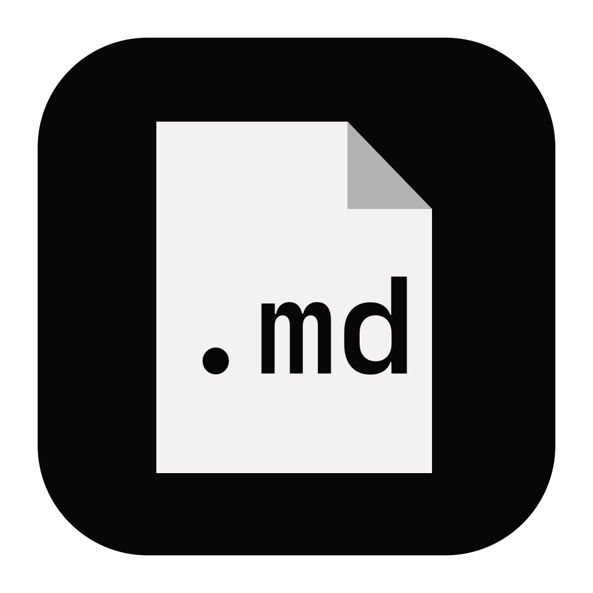
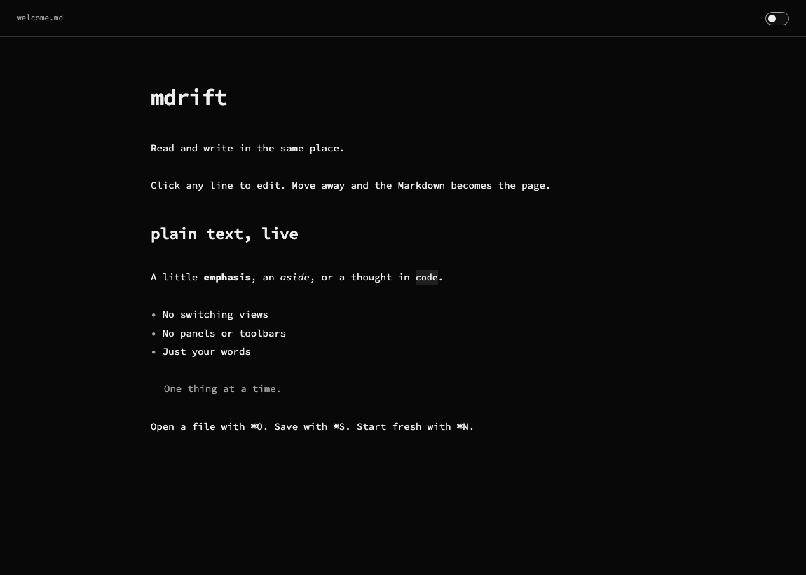

<p align="center"></p>

# mdrift

**Plain text, live.** A small, offline Markdown reader and editor for macOS.

Read and write in one surface. Click a passage to edit its Markdown; move away to render it. Native tabs and windows, Source Code Pro, and light and dark themes.



## Install

Open `mdrift.dmg` and drag **mdrift.app** into **Applications**. The app runs locally with no account, server, or network connection. macOS 13 or later is required; builds target Apple Silicon or Intel according to the build machine.

Builds from this repository are ad-hoc signed, not notarized by Apple. Downloaded builds may require approval in **System Settings → Privacy & Security** on first launch.

If you used the earlier app named **Markdown**, quit it before starting mdrift. On first launch, mdrift copies its draft backups, theme, and last-file preference. The original backups remain intact. Because the app name has changed, installing mdrift does not replace `Markdown.app` automatically.

## Use

| Shortcut                        | Action                                |
| ------------------------------- | ------------------------------------- |
| ⌘T or ⌘N                        | New document in a tab                 |
| ⌘⇧N                             | New window                            |
| ⌘O                              | Open one or more files in tabs        |
| ⌘W                              | Close the current tab                 |
| ⌘⇧W                             | Close the current window and its tabs |
| Control-Tab / Control-Shift-Tab | Next / previous tab                   |
| ⌘S / ⌘⇧S                        | Save / Save As                        |
| ⌘Z / ⌘⇧Z                        | Undo / redo                           |

Use the tab bar's **+** to add a tab. The **Window** menu can move a tab into a new window or merge windows. Each document has its own edits, undo history, cursor, and scroll position. Opening an already-open file selects its existing tab.

Click a table or code block to edit its source. Click task checkboxes to update them. ⌘-click a link to follow it; relative Markdown links open in tabs.

### Files and recovery

- Files change on **Save**. Closing an edited document asks whether to save it.
- External changes trigger a prompt before overwriting. A file open in another tab cannot be overwritten through Save As.
- UTF-8 files up to 10 MB are supported. UTF-8 byte-order marks and Windows line endings are retained.
- Images inside the document's folder work locally. Remote images stay placeholders, and raw HTML is shown as text.
- Drafts are backed up after a half-second pause in `~/Library/Application Support/local.mdrift/Drafts/`. After an interrupted session, drafts reopen together as tabs.
- Normal startup otherwise reopens the last saved file. Full window layouts are not restored.

### Create a file in Finder

Double-click **New Markdown File.workflow**, included in the disk image, to install the optional Finder action. Then right-click a folder or an existing file and choose **New Markdown File**.

It creates and selects `Untitled.md` inside the folder or beside the file. Press **Return** to rename it. Existing names receive a number instead of being overwritten. Finder requires a selected item; the action does not appear in the empty-background menu.

## Build

Requires macOS, Xcode Command Line Tools, Node.js 22+, and Python 3. Run from the repository root:

```sh
npm ci --ignore-scripts
npm run build
npm run package
```

Outputs:

- `build/mdrift.app` — runnable app bundle
- `dist/mdrift.dmg` — installer disk image
- `dist/New Markdown File.workflow` — optional Finder action

Building never installs the app. To cross-compile, set `MDRIFT_ARCH=arm64` or `MDRIFT_ARCH=x86_64`; native tests must run on a compatible machine.

## Test and contribute

```sh
npx playwright install chromium
npm test
npm run test:native
```

The editor tests run in Chromium. Native tests exercise the actual AppKit and WebKit app with isolated preferences and temporary files. See [CONTRIBUTING.md](CONTRIBUTING.md) for the code map, formatting, and test details. No AI tools are required.

## License

[MIT](LICENSE). Bundled dependencies retain their own licenses; see [third-party notices](THIRD_PARTY_NOTICES.md).
